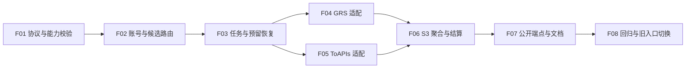

# 统一媒体生成：P0 特性拆分与推进顺序

日期：2026-10-15。状态：本文件保留拆分基线；F01—F08 已形成统一测试版本，当前结果见 [整体交付记录](implementation-status.md)。

需求依据：[PRD v1.2-draft](prd.md)。上游依据：[模型能力对照表](capability-matrix.md)。代码核对快照：`661b4ba3613c3e225301f8600d045eb677bee40f`。

本文件把已确认的 P0 范围拆为可分别编写 `spec.md` 和 `plan.md` 的特性。它不是 `tasks.md`，不预先决定数据表、锁实现或适配类名；这些由各特性的 `plan` 阶段确定。基础管理端能力和逐模型文档都属于 P0。

## 1. 共同边界

- 只对配置了媒体路由的 Composite 分组开放新协议；其它分组现有行为保持。
- 新协议是四个已确认的创建/查询端点。创建 HTTP 202；公开状态只有 queued / in_progress / completed，进度为 0 / 50 / 100。
- 路径决定图片或视频能力；合法输入只向完整支持参数的候选分发；无 schema 或参数不匹配在创建前拒绝。prompt 是否必填由模型和输入模式决定；图片尺寸维持比例 + metadata.resolution，不新增 output_size。Seedream 5.0 Pro 图层分解不纳入本期。
- 无可用账号仍可创建本地任务，最终 completed + error 并释放冻结资金；不能伪造一个账号满足旧创建条件。
- 结果在所有子任务结束、可交付结果转存 S3、正式扣费或额度释放完成后一次性公开；按实际成功交付结果收费。
- 候选明确未受理才可切换；受理不明或已受理不得重新生成。客户端不提供 Idempotency-Key，不等于内部可以重复提交或扣费。
- 账号共享额度属于管理员账号管理；用户只管理自己的 API Key 额度。解除 GRS Composite 目标排除，不解除其用户平台额度排除；ToAPIs 同样不加入用户平台额度。
- F01—F07 是内部交付切片，必须全链路贯通后才对外开放。开发中可使用内部服务与测试验证切片，不能上线一个无资金预留、无 S3 交付或无失败释放的半成品路径。
- 旧 GRS 三接口在 F08 切换时直接停用，无迁移期、无等待旧任务排空条件；不连带关闭其它媒体入口。

## 2. 特性清单

| 编号 | 特性 | 必须交付 | 依赖 |
| --- | --- | --- | --- |
| F01 | 统一协议、模型能力配置与严格校验 | 图片/视频请求与响应契约；按公开模型及媒体类型维护 schema；基础模板；管理员配置与错误提示；顶层/metadata 白名单、类型/枚举/范围/组合约束；规范化输入和可定位字段错误 | PRD 与能力清单 |
| F02 | ToAPIs 账号与 Composite 媒体候选路由 | ToAPIs 账号凭证、状态、账号测试及共享总/日/周额度配置；GRS 与 ToAPIs 混用；按路径和 public_model 获取有序候选；参数完整支持筛选；管理员可预览候选；用户额度边界 | F01 |
| F03 | 持久任务、预留和恢复基础 | 本地父任务与上游执行单元关系；创建事务及费用依据快照；用户余额/API Key 额度的并发预留与释放基础；账号提交前绑定；任务租约/接管/受理状态记录；重启后的恢复入口 | F01、F02 |
| F04 | GRS.AI 图片/视频生成适配 | 基于已核实 GRS 协议的参数转换、提交、状态查询和结果归一；同步/异步上游都接入后台任务；受理结果分类；已有任务固定原账号；文档与源码覆盖差异逐项消除 | F01—F03 |
| F05 | ToAPIs 图片/视频生成适配 | 适配 ToAPIs 已提供的统一异步图片/视频协议与独立 Midjourney 生成协议；逐模型字段差异、原始 model ID、任务/结果解析、素材角色、精确规格和多结果处理；不因目录标注 Gemini/Vertex 就直接调用原厂协议 | F01—F03 |
| F06 | S3 交付、结果聚合与最终结算 | 图片 n 自动拆分；子任务终态聚合；S3 下载/转存及恢复；部分成功；全部结束后 capture 成功部分并释放差额；全失败释放；无重复交付/扣费；完成与过期时间 | F03、F04、F05 |
| F07 | 四个公开端点、查询隔离与下游文档 | Composite 按媒体路由分流；只读 GET；同用户且同 API Key 归属检查；媒体类型与查询路径一致；公开投影三状态和秒级时间；统一及逐模型参数文档、成功/部分成功/失败示例 | F01—F06 |
| F08 | 全链路回归与旧接口切换 | 全 AC 回归；故障注入与账务对账证据；其它平台入口兼容验证；旧三接口直接停用；管理员必需任务诊断可用；生产上线准备说明 | F01—F07 |

F04 与 F05 的规格可引用同一内部执行契约；ToAPIs 不应被迫套用 GRS 原生请求/响应。F03 的预留基础和 F06 的最终结算是同一个账务生命周期的两个部分，必须联合验收。

## 3. 依赖图与推荐实施顺序

按 F01 → F02 → F03 → F04 → F05 → F06 → F07 → F08 逐特性执行 `specify → plan → tasks → implement`。跨切片预先确认的共用约定写入最先涉及它的 `plan.md`，后续方案引用；不另行维护一份相互漂移的完整 TRD。不把整份 PRD 一次性作为一个巨大实现特性。

第一项可启动规格是 F01：统一协议、模型能力配置与严格校验。其 `plan` 需要约定供 F02—F07 复用的规范化请求、能力匹配结果和错误边界；任务、账务的详细方案由 F03/F06 展开。模型特殊操作的未决项只阻塞相关配置和适配，不阻塞公共协议与已确认模型。

## 4. PRD 验收标准归属

“主归属”负责提供验收证据，联合切片负责一起验证接缝，不以局部通过替代完整场景。

| PRD 验收 | 主归属 | 联合验证 |
| --- | --- | --- |
| AC-001 图片创建 202 与本地 ID | F07 | F01、F03 |
| AC-002 视频创建 202 | F07 | F01、F03 |
| AC-003 双平台 Composite 分发 | F02 | F04、F05、F07 |
| AC-004 上游非终态 | F04、F05 | F03、F07 |
| AC-005 S3 结果、完成与过期时间 | F06 | F07 |
| AC-006 部分成功与按成功计费 | F06 | F03、F04、F05、F07 |
| AC-007 全失败/无账号结束并释放 | F06 | F02、F03、F07 |
| AC-008 正式扣费一次/失败释放 | F06 | F03 |
| AC-009 S3 失败保持处理中并重试 | F06 | F03、F07 |
| AC-010 重启后继续原任务 | F03 | F04、F05、F06 |
| AC-011 同用户与同 Key 查询隔离 | F07 | F03 |
| AC-012 非目标分组保持原行为 | F07 | F02、F08 |
| AC-013 旧三接口立即停用 | F08 | F07 |
| AC-014 模型参数校验、转换、错误 | F01 | F02、F04、F05、F07 |
| AC-015 错误媒体路径拒绝 | F01 | F07 |
| AC-016 同名模型双媒体能力 | F01 | F02、F07 |
| AC-017 缺 schema 拒绝 | F01 | F07 |
| AC-018 基础模板配置同协议新模型 | F01 | F02、F04、F05 |
| AC-019 顶层字段严格白名单 | F01 | F07 |
| AC-020 metadata 严格字段约束 | F01 | F07 |
| AC-021 只选支持全部规格的候选 | F02 | F01、F03 |
| AC-022 全候选参数不支持返回 400 | F02 | F01、F07 |
| AC-023 n 拆分不被原生数量误排除 | F06 | F01、F02、F04、F05 |
| AC-024 固定 0/50/100，完成不等于成功 | F07 | F03、F06 |
| AC-025 首期参数文档 | F07 | F01、F04、F05 |
| AC-026 按模型与输入模式决定 prompt 必填 | F01 | F04、F05、F07 |
| AC-027 普通生图可用、图层分解拒绝 | F01 | F05、F07 |

F08 对 AC-001—AC-027 统一回归。最低还需覆盖：并发创建不能透支 Key 可用额度；重试耗尽不能留下永久冻结；配置修改不改变已创建任务的参数与计价；错误响应不泄露账号凭证；上游已消耗与下游未交付的账务可诊断。

## 5. 代码复用与已核实差距

以下路径相对于仓库根目录，行号为上述快照；后续改动后应重新定位。

| 位置 | 可复用内容 | 必须处理的差距 |
| --- | --- | --- |
| `backend/internal/server/routes/gateway.go:76,92,108,194,260,264,267,282,289` | 现有图片/视频分流、公共鉴权/模型准入及挂载点 | 当前图片只走 OpenAI/Grok，Composite 视频仍走 Grok；需在现有单目标解析之前保留媒体候选语义，查询不能依赖 POST model 推断 |
| `backend/ent/schema/composite_model_route.go:62`；`backend/internal/service/composite_model_route.go:21,97` | 已有 endpoint 字段、路由 CRUD/预览 | 服务当前缺 videos，未知 endpoint 会归一成 any，不能仅添加 UI 选项 |
| `backend/internal/service/composite_route_resolver.go:71,115,151` | 当前路由与账号映射规则 | 只返回单一匹配，跨平台账号归属会判歧义；媒体必须保留有序多候选及参数匹配信息 |
| `backend/internal/domain/platforms.go:86,91` | 平台登记、Composite 目标和用户平台额度两个判断 | 只解除 Composite 目标排除；用户平台额度排除保留，并对 ToAPIs 同样生效 |
| `frontend/src/constants/platforms.ts:36`；`frontend/src/constants/platformCatalog.ts:80` | 前端平台选项与额度平台目录 | 账号平台加入不能自动导致用户额度选项加入 |
| `frontend/src/views/admin/GroupsView.vue:3923,4105,4667,4783`；`backend/internal/service/admin_group.go:341` | 路由编辑/预览、分组账号处理 | 补视频与多候选；核对前后端显式 GRS 排除和组账号复制逻辑 |
| `backend/internal/service/grsai_task_service.go:38,47,78`；`backend/internal/repository/grsai_settlement_repo.go:138,212` | 事务创建、加密请求、余额 hold 的模式 | 强制 grsai 分组、必须先有账号；计价包含账号倍率；需支持 Composite、账号后绑、公共模型费用依据 |
| `backend/ent/schema/grsai_settlement.go:30,45` | 现持久任务/结算记录 | 单一账号和上游任务 ID，无统一父子执行聚合语义 |
| `backend/internal/service/grsai_task_runtime.go:129,158,187,194,201,309` | claim/fencing、原账号轮询、S3 后完成 | 重试耗尽有 manual_review；不能原样当作公开终态并永久冻结 |
| `backend/internal/repository/usage_billing_repo.go:138,225,340,354` | 余额预留、事务结算/额度累计 | 现冻结只涉及余额；Key/账号用量在 capture 时累计，需补并发预留与部分 capture/release |
| `backend/internal/service/grsai_result_persistence.go:28`；`backend/internal/service/grsai_video_persistence.go:24` | 图片/视频下载与 S3 转存 | 旧 results 对象数组需统一为 type + string[]；已转存结果应能恢复复用 |
| `backend/internal/service/grsai_task_view.go:9`；`backend/internal/repository/grsai_settlement_repo.go:645`；`backend/internal/handler/grsai_delivery_handler.go:93` | 查询归属过滤、任务投影 | 时间、状态、过期字段和分组检查均与新契约不同 |

ToAPIs 在当前代码中没有账号类型和生成适配；已有名称为 `ToAPIsResponse` 的上传测试不代表存在平台实现。

## 6. 技术方案必须回答的接缝问题

1. **预留与创建**：任务创建、用户资金/API Key 额度预留如何形成可恢复的一次操作？余额不足或 Key 额度不足的 HTTP 错误要与“上游无账号但已创建任务”分开。
2. **计价与账号后绑**：创建按 public_model 和输出规格计算费用；在尚无账号时如何固定用户侧价格？上游模型、账号成本与用户计价不能混成一个字段。
3. **父子与拆分**：单一请求的 n、上游一请求多图、MJ 四宫格一个结果如何对应交付数量与结算单元？只支持单张的候选仍可因拆分被保留。
4. **受理不明**：断网或进程崩溃时能否查回原任务？若没有上游 ID，也没有查询凭据，不能凭空假定可恢复或重新提交；必须定义有限处理与最终释放。
5. **结果与终态**：如何确认全部执行单元结束，保留已转存结果，收取成功交付部分并释放余款，再一次性公开完成？不能先返回 completed 再异步补扣费。
6. **租约与重复操作**：接管、重复轮询、重复下载、重复结算分别靠什么记录避免重复生成、计费或丢结果？具体事务与约束在 plan 中决定。
7. **共享账号额度**：账号用量独立于用户平台额度；多用户并发、账号停用、提交后超时以及上游已消耗但下游交付失败时如何控制和解释账号占用？具体计量依据需方案明确。
8. **输入语义**：image_urls、首尾帧、有序参考素材、视频/音频等如何保持角色与顺序？像素尺寸与比例冲突不得静默覆盖；具体受支持字段以模型矩阵为依据。
9. **有效期**：复用现有 S3 管理员配置时，结果可读有效期、实际对象保留和任务记录保留如何区分？默认值与上限在 plan 中说明，改变保留政策再提请确认。
10. **管理配置一致性**：schema、路由、模板、计价及管理员诊断的最小界面随 P0 完成；不得依赖未交付的 P1 工具才能开启模型或处理资金故障。

## 7. Spec-Kit 与验证准备

- 核对时仓库根目录尚无 `.specify/`，统一媒体目录尚无 `spec.md / plan.md / tasks.md`。本轮不将这份拆分清单冒充 Spec-Kit 生成结果。
- 进入 F01 时按项目现有约束补齐所需 Spec-Kit 项目结构和模板；已有其它 specs 可供风格参考，不代表初始化完成。
- 对每个特性先写可验收的 spec，再写 plan；共用设计引用前序 plan。模型能力未知要明确标记，不能把目录枚举等同于可上线配置。
- 后续验证全部通过 Docker Compose：后端 unit 使用 `docker compose -f deploy/docker-compose.test.yml run --rm backend-test`；前端使用 `docker compose -f deploy/docker-compose.test.yml run --rm --no-deps frontend-test`；集成使用 `docker compose -f deploy/docker-compose.test.yml run --rm --no-deps backend-integration`。
- 以上代码位置及“尚无结构”描述是拆分时的历史基线；最终已实现代码和验证证据以整体交付记录为准。未执行生产操作或真实付费生成。
